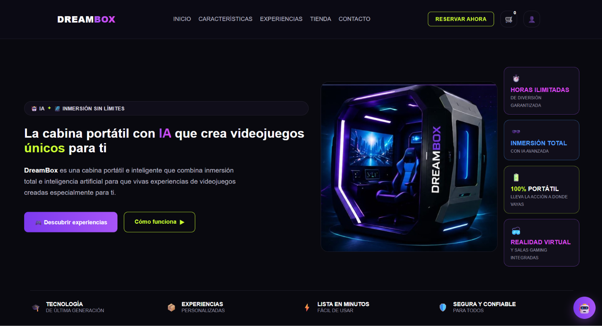
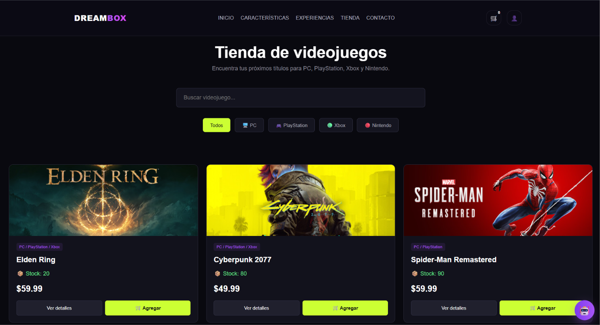
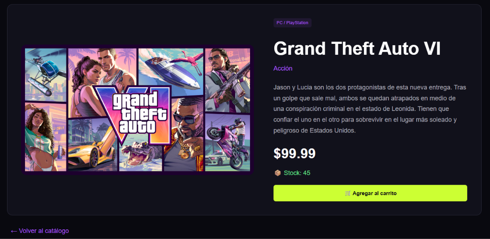
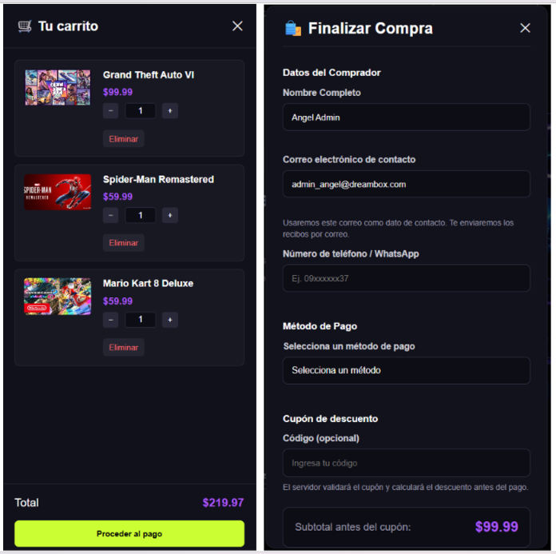
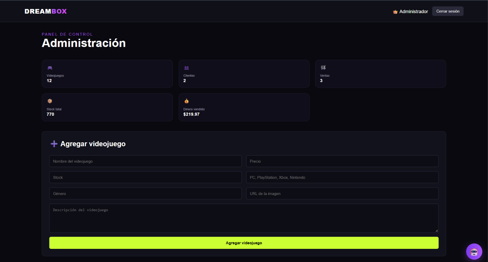

<div align="center">
🎮 DreamBox

**La cabina portátil con IA que crea videojuegos únicos para ti**


</div>

---

## 📑 Tabla de contenidos

1. [Descripción general](#-descripción-general)
2. [Características principales](#-características-principales)
3. [Tecnologías utilizadas](#-tecnologías-utilizadas)
4. [Vista previa](#-vista-previa)
5. [Estructura del proyecto](#-estructura-del-proyecto)
6. [Instalación y configuración](#-instalación-y-configuración)
7. [Variables de entorno](#-variables-de-entorno)
8. [Base de datos](#-base-de-datos)
9. [API REST](#-api-rest)
10. [Uso del proyecto](#-uso-del-proyecto)
11. [Despliegue](#-despliegue)
12. [Limitaciones conocidas](#-limitaciones-conocidas)
13. [Autor](#-autor)

---

## 📖 Descripción general

**DreamBox** es una cabina portátil de videojuegos con inteligencia artificial, diseñada para ofrecer experiencias de entretenimiento inmersivas y personalizadas.

Muchas personas quieren vivir experiencias de videojuegos más inmersivas y personalizadas, pero no tienen acceso a equipos costosos o a juegos que se adapten a sus gustos. DreamBox propone una cabina portátil que combina inmersión total e IA para que cualquiera pueda vivir esa experiencia.

Este repositorio contiene el **sitio web de DreamBox**, que incluye:

- Una página de presentación del producto.
- Una **tienda de videojuegos** (PC, PlayStation, Xbox y Nintendo) con carrito y proceso de compra.
- Un sistema de **registro e inicio de sesión** de usuarios.
- Un **panel de administración**.
- Un **asistente virtual (DreamBot)** que recomienda juegos del catálogo.
- Un **formulario de contacto**.
- Una **API REST** en Node.js que conecta todo con una base de datos MongoDB.

---

## ✨ Características principales

### 🛍️ Tienda
- Catálogo de videojuegos cargado desde la API, con **buscador por nombre**.
- **Filtros por plataforma**: Todos, PC, PlayStation, Xbox y Nintendo (también mediante la URL, por ejemplo `catalogo.html?plataforma=PC`).
- **Página de detalle** de cada videojuego (`detalle.html?id=<id>`) con descripción, género, precio y stock.
- Indicador de **stock** y botón deshabilitado cuando el producto está agotado.
- **Carrito de compras** (panel lateral) con cambio de cantidades, eliminación de productos, contador y total. Se conserva en el `localStorage` del navegador.
- **Proceso de compra** (checkout) con validación de nombre, correo, teléfono y selección de método de pago, y ventana de agradecimiento con acceso a WhatsApp.

### 🔐 Cuentas de usuario
- **Registro** (nombre, correo y contraseña de mínimo 6 caracteres) e **inicio de sesión**.
- Contraseñas cifradas con **bcrypt** y sesiones mediante **JSON Web Tokens (JWT)** con duración de 7 días.
- Botón para mostrar u ocultar la contraseña.
- Menú de usuario con nombre, **cierre de sesión** con confirmación y acceso al panel de administrador (solo para administradores).
- Roles: `usuario` y `admin`.

### 👑 Panel de administración (`admin.html`)
- **Estadísticas**: videojuegos, clientes, ventas, stock total y dinero vendido.
- **Gestión de inventario**: agregar, editar y eliminar videojuegos, y modificar el stock directamente en la tabla.
- **Usuarios registrados**: listado y cambio de rol (el servidor impide dejar al sistema sin administradores).
- **Ventas realizadas**: cliente, correo, productos, total y fecha.
- **Mensajes de contacto** recibidos desde el formulario del sitio.
- Acceso protegido: se verifica el rol en el servidor antes de mostrar el panel.

### 🤖 DreamBot (asistente con IA)
- Widget de chat flotante disponible en las páginas del sitio.
- Recomienda videojuegos **únicamente del catálogo existente**, usando la API de Groq desde el servidor (la clave nunca llega al navegador).
- Límite simple de un mensaje cada 2 segundos por IP.

### 🌐 Sitio web
- Página de inicio con secciones: *hero*, características, experiencias, vista de la tienda y contacto.
- **Formulario de contacto** con validación (requiere haber iniciado sesión); los mensajes se guardan en la base de datos.
- Diseño **responsive** con menú hamburguesa para pantallas menores a 1024 px.
- Ventanas modales personalizadas (reemplazan a `alert` y `confirm`).
- Etiquetas *Open Graph* y *Twitter Card* para compartir el sitio en redes y WhatsApp.

---

## 🧰 Tecnologías utilizadas

### Frontend

| Tecnología | Uso |
|---|---|
| [HTML](https://developer.mozilla.org/es/docs/Web/HTML) | Estructura de las páginas |
| [CSS](https://developer.mozilla.org/es/docs/Web/CSS) | Estilos, variables CSS, Grid, Flexbox y diseño responsive (`styles.css`) |
| [JavaScript (vanilla)](https://developer.mozilla.org/es/docs/Web/JavaScript) | Lógica del cliente, consumo de la API con `fetch` (`script.js`) |

> No se utiliza ningún framework ni biblioteca de frontend.

### Backend

| Tecnología | Versión | Uso |
|---|---|---|
| [Node.js](https://nodejs.org/es) | ≥ 20.19.0 (requisito de Mongoose 9) | Entorno de ejecución |
| [Express](https://expressjs.com/es/) | ^5.3.0 | Servidor y rutas de la API |
| [Mongoose](https://mongoosejs.com/) | ^9.11.2 | Modelado y acceso a MongoDB |
| [bcryptjs](https://github.com/dcodeIO/bcrypt.js) | ^3.0.3 | Cifrado de contraseñas |
| [jsonwebtoken](https://github.com/auth0/node-jsonwebtoken) | ^9.0.3 | Autenticación con JWT |
| [cors](https://github.com/expressjs/cors) | ^2.8.6 | Control de orígenes permitidos |
| [dotenv](https://github.com/motdotla/dotenv) | ^18.0.8 | Variables de entorno |

### Base de datos y servicios externos

| Servicio | Uso |
|---|---|
| [MongoDB](https://www.mongodb.com/) | Base de datos (usuarios, productos, ventas y mensajes) |
| [Groq API](https://console.groq.com/docs) | Modelo de lenguaje del asistente DreamBot (endpoint `chat/completions`) |
| [Render](https://render.com/) | Alojamiento de la API (`https://dreambox.onrender.com`) |
| [WhatsApp](https://faq.whatsapp.com/5913398998672934) | Enlace de contacto (`wa.me`) |

---

## 🖼️ Vista previa

| Inicio | Catálogo |
|---|---|
|  |  |

| Detalle de videojuego | Carrito y checkout |
|---|---|
|  | |

| Panel de administración | DreamBot |
|---|---|
|  |  |

---

## 📁 Estructura del proyecto

```
DreamBox_/
├── assets/              # Imágenes del sitio (cabina, favicon, imagen para redes, juegos catalogo , capturas de pantalla)
├── index.html           # Página de inicio (hero, características, tienda, contacto)
├── catalogo.html        # Catálogo completo con buscador y filtros
├── detalle.html         # Detalle de un videojuego
├── login.html           # Inicio de sesión
├── registro.html        # Creación de cuenta
├── admin.html           # Panel de administración
├── styles.css           # Estilos de todo el sitio
├── script.js            # Lógica del cliente (carrito, sesión, catálogo, admin, chatbot)
├── server.js            # API REST (Express + Mongoose)
├── package.json         # Dependencias y script de inicio
├── package-lock.json    # Versiones exactas de dependencias
└── .gitignore           # Excluye .env y node_modules/
```

| Archivo | Descripción |
|---|---|
| `server.js` | Define los modelos (`Contacto`, `Usuario`, `Producto`, `Venta`), los *middlewares* de autenticación (`verificarToken`, `soloAdmin`), todas las rutas `/api/*`, la siembra inicial de productos y el arranque del servidor. |
| `script.js` | Contiene `API_URL`, la comunicación con la API, el carrito, el checkout, el catálogo, los filtros, el panel admin, la validación del formulario de contacto, el menú móvil y el chatbot. |
| `styles.css` | Variables de color, componentes y *media queries* responsive. |
| `aseets/` | Variables de color, componentes y *media queries* responsive. |


---

## 🚀 Instalación y configuración

El proyecto se divide en dos partes que se ejecutan por separado: la **API** (Node.js) y el **frontend** (archivos estáticos).

### Requisitos previos

- [Node.js](https://nodejs.org/es) **20.19.0 o superior**
- [Git](https://git-scm.com/)
- Una base de datos MongoDB (por ejemplo, un clúster gratuito en [MongoDB Atlas](https://www.mongodb.com/atlas) o una instancia local)
- (Opcional) Una clave de API de [Groq](https://console.groq.com/) para el asistente DreamBot

### 1. Clonar el repositorio

```bash
git clone https://github.com/AngelGuayanay20/DreamBox_.git
cd DreamBox_
```

### 2. Instalar dependencias

```bash
npm install
```

### 3. Configurar las variables de entorno

Crea un archivo `.env` en la raíz del proyecto (ya está ignorado por Git). Consulta la sección [Variables de entorno](#-variables-de-entorno).

### 4. Iniciar la API

```bash
npm start
```

Si todo es correcto verás en consola: `API lista en el puerto 3001` (o el puerto que hayas definido).

### 5. Apuntar el frontend a tu API local

En la **primera línea de `script.js`** la URL de la API está fijada a la versión desplegada:

```js
const API_URL = "https://dreambox.onrender.com";
```

Para trabajar en local, cámbiala por:

```js
const API_URL = "http://localhost:3001";
```

### 6. Servir el frontend

El servidor `server.js` **solo expone la API**; no sirve los archivos HTML. Abre el frontend con cualquier servidor de archivos estáticos, por ejemplo la extensión **Live Server** de VS Code (normalmente en `http://127.0.0.1:5500`).

> ⚠️ Si defines `ALLOWED_ORIGINS`, incluye exactamente el origen desde el que abres el frontend (por ejemplo `http://127.0.0.1:5500`, sin barra final).

---

## 🔑 Variables de entorno

Crea un archivo `.env` en la raíz con el siguiente formato. **Nunca subas este archivo al repositorio ni compartas sus valores.**

```env
MONGODB_URI=tu_cadena_de_conexion_de_mongodb
JWT_SECRET=una_cadena_larga_y_aleatoria
ADMIN_EMAIL=correo_del_administrador@ejemplo.com
ALLOWED_ORIGINS=http://127.0.0.1:5500
AI_API_KEY=tu_clave_de_groq
AI_MODEL=identificador_del_modelo_de_groq
PORT=3001
```

| Variable | Obligatoria | Descripción |
|---|:---:|---|
| `MONGODB_URI` | ✅ | Cadena de conexión a MongoDB. Si falla la conexión, el servidor se cierra. |
| `JWT_SECRET` | ✅ | Secreto con el que se firman y verifican los tokens de sesión. |
| `ADMIN_EMAIL` | ✅ Para tener un admin | Quien se **registre** con este correo recibe el rol `admin` automáticamente. |
| `ALLOWED_ORIGINS` | ❌ | Orígenes permitidos por CORS, separados por comas. Si no se define, se permiten todos (`*`). |
| `AI_API_KEY` | ❌ (Requerida para DreamBot) | Clave de la API de Groq. |
| `AI_MODEL` | ❌ (Requerida para DreamBot) | Identificador del modelo de Groq a utilizar. El repositorio no fija un modelo; elige uno disponible en tu cuenta de Groq. |
| `PORT` | ➖ (Depende si se usa en otro lado ) | Puerto del servidor. Por defecto `3001`. |

---

## 🗄️ Base de datos

DreamBox usa **MongoDB** a través de **Mongoose**. La conexión se abre al iniciar el servidor con `MONGODB_URI` y, una vez conectada, se ejecuta la siembra inicial de productos.

### Colecciones (modelos)

| Modelo | Campos principales |
|---|---|
| **Usuario** | `nombre`, `email` (único, en minúsculas), `passwordHash`, `rol` (`usuario` \| `admin`) |
| **Producto** | `id` (numérico, único), `nombre`, `precio`, `stock`, `plataforma` (arreglo), `genero`, `imagen`, `descripcion` |
| **Venta** | `usuario` (`nombre`, `email`), `productos` (`id`, `nombre`, `precio`, `cantidad`), `total` |
| **Contacto** | `nombre`, `email`, `telefono`, `mensaje`, `leido` |

Todos los modelos incluyen `createdAt` y `updatedAt` automáticos.

### Datos iniciales

Si la colección de productos está vacía, el servidor inserta automáticamente 6 videojuegos de ejemplo: *Elden Ring*, *Cyberpunk 2077*, *Spider-Man Remastered*, *The Legend of Zelda: Tears of the Kingdom*, *Mario Kart 8 Deluxe* y *Forza Horizon 5*.

### Lógica de compra

Al confirmar una compra, el servidor **recalcula el total con los precios de la base de datos** (no confía en el precio enviado por el navegador), descuenta el stock de forma condicional y, si algún producto no tiene stock suficiente, **revierte** los descuentos ya realizados antes de responder con error. Si todo sale bien, registra la venta.

---

## 🔌 API REST

Base URL por defecto en local: `http://localhost:3001`

| Método | Ruta | Acceso | Descripción |
|---|---|---|---|
| `POST` | `/api/registro` | Público | Crea una cuenta |
| `POST` | `/api/login` | Público | Inicia sesión y devuelve el token JWT |
| `GET` | `/api/yo` | Usuario autenticado | Devuelve los datos del usuario del token |
| `GET` | `/api/productos` | Público | Lista los videojuegos |
| `POST` | `/api/productos` | Admin | Crea un videojuego |
| `PUT` | `/api/productos/:id` | Admin | Actualiza un videojuego (o solo su stock) |
| `DELETE` | `/api/productos/:id` | Admin | Elimina un videojuego |
| `POST` | `/api/compra` | Usuario autenticado | Registra una compra y descuenta stock |
| `GET` | `/api/ventas` | Admin | Lista las ventas |
| `GET` | `/api/usuarios` | Admin | Lista los usuarios |
| `PUT` | `/api/usuarios/:id/rol` | Admin | Cambia el rol de un usuario |
| `POST` | `/api/contacto` | Usuario autenticado | Guarda un mensaje de contacto |
| `GET` | `/api/contacto` | Admin | Lista los mensajes de contacto |
| `POST` | `/api/chat` | Público (limitado por IP) | Consulta al asistente DreamBot |

Las rutas protegidas esperan la cabecera `Authorization: Bearer <token>`.

---

## 🕹️ Uso del proyecto

### Como visitante o cliente

1. Entra a la página de inicio y explora las secciones del producto.
2. Ve a **TIENDA** para ver el catálogo. Usa el buscador o los filtros por plataforma.
3. Pulsa **Ver detalles** para abrir la ficha del videojuego o **🛒 Agregar** para añadirlo al carrito.
4. Abre el carrito (🛒) para ajustar cantidades y pulsa **Proceder al pago**.
5. Si no has iniciado sesión, el sistema te dirigirá a **Iniciar sesión**. Si aún no tienes cuenta, crea una en **Crear cuenta**.
6. Completa nombre, correo, teléfono y método de pago, y pulsa **Confirmar compra**.
7. Pregúntale a **DreamBot** (botón 🤖 en la esquina inferior derecha) qué juego te conviene.
8. Para escribirnos, usa el formulario de la sección **Contacto** (requiere sesión iniciada).

### Como administrador

1. Regístrate con el correo definido en `ADMIN_EMAIL` e inicia sesión (serás redirigido a `admin.html`).
2. Desde el panel puedes:
   - Agregar un videojuego con el formulario (los géneros y plataformas se escriben como texto; las plataformas se separan con comas).
   - **Editar** o **eliminar** videojuegos, y cambiar su stock directamente en la tabla.
   - Cambiar el **rol** de otros usuarios.
   - Revisar las **ventas** y los **mensajes de contacto**.

---

## ☁️ Despliegue

Según la configuración del proyecto:

| Parte | Plataforma | URL |
|---|---|---|
| **API (backend)** | Render | `https://dreambox.onrender.com` |
| **Frontend** | GitHub Pages *(según las etiquetas Open Graph de `index.html`)* | `https://angelguayanay20.github.io/DreamBox_/` |

**Para desplegar la API en Render (u otro servicio similar):**

1. Crea un servicio web de Node.js conectado a este repositorio.
2. Comando de instalación: `npm install`
3. Comando de inicio: `npm start`
4. Define las [variables de entorno](#-variables-de-entorno) en el panel del servicio. En producción, establece `ALLOWED_ORIGINS` con la URL de tu frontend.

**Para el frontend:** publica los archivos estáticos (HTML, CSS, JS y `assets/`) y verifica que `API_URL` en `script.js` apunte a tu API desplegada.

> ⏱️ En planes gratuitos de Render el servidor puede "dormirse"; la primera petición puede tardar unos segundos. El sitio muestra mensajes informando cuando no logra conectarse.

---

## ⚠️ Limitaciones conocidas

Para ser transparentes sobre el estado actual del proyecto:

- 💳 **No hay pasarela de pago real.** El checkout exige elegir un método (PayPal, tarjeta o transferencia), pero solo se valida la selección; no se procesa ningún pago.
- 🏷️ **Los cupones de descuento aún no están disponibles.** El campo existe, pero si se completa el sitio indica que no se pueden usar.
- 📧 El checkout indica que se enviarán recibos por correo, pero el código no incluye envío de correos.
- 🔗 Los enlaces de Instagram, Facebook y TikTok del pie de contacto están como marcadores (`#`).
- 🧪 El proyecto no incluye pruebas automatizadas ni un script de desarrollo (solo `npm start`).

---

## 👤 Autor

**Angel Guayanay**

- GitHub: [@AngelGuayanay20](https://github.com/AngelGuayanay20)
- Ubicación: Quito, Ecuador 🇪🇨

---


<div align="center">

*No juegas un videojuego... vives uno creado especialmente para ti.* 🎮

© 2026 DreamBox. Todos los derechos reservados.

</div>
