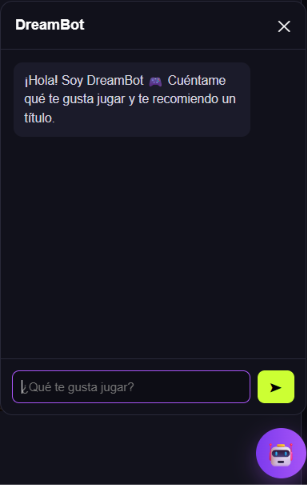

<div align="center">

# 🎮 DreamBox

**La cabina portátil con IA que crea videojuegos únicos para ti**

[](https://developer.mozilla.org/es/docs/Web/HTML)
[](https://developer.mozilla.org/es/docs/Web/CSS)
[](https://developer.mozilla.org/es/docs/Web/JavaScript)
[](https://nodejs.org/)
[](https://expressjs.com/)
[](https://www.mongodb.com/)
[](https://jwt.io/)

</div>

---

## 📑 Tabla de contenido


- [📖 Descripción general](#-descripción-general)
- [✨ Características principales](#-características-principales)
- [🧰 Tecnologías utilizadas](#-tecnologías-utilizadas)
- [🖼️ Vista previa](#️-vista-previa)
- [📁 Estructura del proyecto](#-estructura-del-proyecto)
- [🚀 Instalación y configuración](#-instalación-y-configuración)
- [🔑 Variables de entorno](#-variables-de-entorno)
- [🗄️ Base de datos](#️-base-de-datos)
- [🔌 API REST](#-api-rest)
- [🕹️ Uso del proyecto](#️-uso-del-proyecto)
- [☁️ Despliegue](#️-despliegue)
- [⚠️ Limitaciones conocidas](#️-limitaciones-conocidas)
- [👤 Autor](#-autor)

---

## 📖 Descripción general

**DreamBox** es una cabina portátil de videojuegos con inteligencia artificial, diseñada para ofrecer experiencias de entretenimiento inmersivas y personalizadas.

El proyecto busca combinar videojuegos, tecnología e inteligencia artificial dentro de una experiencia accesible y personalizada para los usuarios.

Muchas personas quieren vivir experiencias de videojuegos más inmersivas y personalizadas, pero no tienen acceso a equipos costosos o a juegos que se adapten a sus gustos. DreamBox propone una cabina portátil que combina inmersión total e IA para que cualquiera pueda vivir esa experiencia.

Este repositorio contiene el desarrollo web de DreamBox y está dividido principalmente en un **frontend** y un **backend**. El frontend proporciona la interfaz con la que interactúa el usuario, mientras que el backend proporciona una API REST encargada de la lógica del sistema y la comunicación con la base de datos.

### 🎯 Objetivo

DreamBox busca ofrecer una experiencia de videojuegos más personalizada mediante:

- Una tienda de videojuegos.
- Gestión de usuarios.
- Sistema de autenticación.
- Administración de productos e inventario.
- Registro de ventas.
- Formulario de contacto.
- Un asistente virtual llamado **DreamBot**.
- Integración con inteligencia artificial.
- Persistencia de información mediante MongoDB.

---

## ✨ Características principales

### 🛍️ Tienda de videojuegos

El sistema incluye un catálogo de videojuegos que permite:

- Consultar los videojuegos disponibles.
- Buscar productos por nombre.
- Filtrar videojuegos por plataforma.
- Consultar información detallada de cada videojuego.
- Visualizar precio y stock.
- Agregar productos al carrito.
- Modificar cantidades.
- Eliminar productos del carrito.
- Consultar el total de la compra.
- Realizar el proceso de checkout.

Las plataformas contempladas incluyen:

- 🖥️ PC
- 🎮 PlayStation
- 🟢 Xbox
- 🔴 Nintendo

---

### 🛒 Carrito de compras

El carrito permite administrar los productos seleccionados antes de realizar una compra.

Entre sus funciones se encuentran:

- Agregar videojuegos.
- Incrementar o disminuir cantidades.
- Eliminar productos.
- Mostrar cantidad total de productos.
- Calcular el importe de la compra.
- Mantener el carrito mediante `localStorage`.

---

### 🔐 Registro e inicio de sesión

DreamBox incorpora un sistema de cuentas de usuario.

Los usuarios pueden:

- Crear una cuenta.
- Iniciar sesión.
- Mantener una sesión mediante JWT.
- Cerrar sesión.
- Consultar su información.
- Acceder a funcionalidades protegidas.

Las contraseñas se almacenan cifradas mediante `hash` utilizando `bcryptjs`.

El sistema contempla dos roles:

| Rol | Descripción |
|---|---|
| `usuario` | Usuario normal del sistema |
| `admin` | Usuario con permisos administrativos |

---

### 👑 Panel de administración

Los usuarios administradores disponen de funcionalidades para administrar diferentes elementos del sistema.

El panel permite:

- **Consultar estadísticas como :** Videojuegos, clientes, ventas, stock total y dinero vendido.
- Gestionar videojuegos.
- Agregar productos.
- Editar productos.
- Eliminar productos.
- Modificar stock.
- **Consultar usuarios registrados :** Listado de personas registradas.
- **Cambiar roles:** Entre `admin` y `usuario`.
- **Consultar ventas:** cliente, correo, productos, total y fecha.
- Consultar mensajes recibidos mediante el formulario de contacto.

El acceso al panel está protegido mediante autenticación y autorización basada en roles.

---

### 🤖 DreamBot (asistente con IA)

DreamBot es el asistente virtual de DreamBox.

Su función principal es ayudar al usuario a encontrar videojuegos del catálogo mediante inteligencia artificial.

El sistema utiliza la API de Groq desde el servidor del backend, evitando exponer directamente la clave de acceso en el navegador.

DreamBot está diseñado para recomendar videojuegos que formen parte del catálogo disponible.

---

### 📩 Formulario de contacto

El sitio incorpora un formulario de contacto mediante el cual los usuarios pueden enviar mensajes.

La información enviada se procesa mediante la API y se almacena en MongoDB.

El panel administrativo permite posteriormente consultar los mensajes recibidos.

---

### 📱 Diseño responsive

La interfaz está diseñada para adaptarse a diferentes tamaños de pantalla.

Incluye elementos como:

- Menú responsive.
- Menú hamburguesa para pantallas pequeñas.
- Diseño adaptable.
- Componentes visuales optimizados para diferentes dispositivos.

---

### 🌐 Integración para redes sociales

El sitio incorpora metadatos para mejorar la forma en que DreamBox se presenta cuando se comparte en plataformas compatibles.

Entre ellos se incluyen:

- Open Graph.
- Twitter Cards.

---

## 🧰 Tecnologías utilizadas

### Frontend

| Tecnología | Uso |
|---|---|
| [HTML](https://developer.mozilla.org/es/docs/Web/HTML) | Estructura de las páginas |
| [CSS](https://developer.mozilla.org/es/docs/Web/CSS) | Estilos, variables CSS, Grid, Flexbox y diseño responsive (`styles.css`) |
| [JavaScript (vanilla)](https://developer.mozilla.org/es/docs/Web/JavaScript) | Lógica del cliente, consumo de la API con `fetch` (`script.js`) |
| Fetch API | Comunicación con el backend |
| LocalStorage | Persistencia del carrito en el navegador |

> No se utiliza ningún framework ni biblioteca de frontend.


---

### Backend

| Tecnología | Versión | Uso |
|---|---|---|
| [Node.js](https://nodejs.org/es) | ≥ v26.13.1 (requisito de Mongoose 9) | Entorno de ejecución |
| [Express](https://expressjs.com/es/) | ^5.3.0 | Servidor y rutas de la API |
| [Mongoose](https://mongoosejs.com/) | ^9.11.2 | Modelado y acceso a MongoDB |
| [bcryptjs](https://github.com/dcodeIO/bcrypt.js) | ^3.0.3 | Cifrado de contraseñas |
| [jsonwebtoken](https://github.com/auth0/node-jsonwebtoken) | ^9.0.3 | Autenticación con JWT |
| [cors](https://github.com/expressjs/cors) | ^2.8.6 | Control de orígenes permitidos |
| [dotenv](https://github.com/motdotla/dotenv) | ^18.0.8 | Variables de entorno |
---

### Base de datos y servicios

| Servicio | Función |
|---|---|
| [MongoDB](https://www.mongodb.com/) | **Base de Datos :** Almacenamiento de usuarios, productos, ventas y contactos |
| [Groq API](https://console.groq.com/docs)| **Inteligencia Artificial:** Modelo de Lenguaje utilizado por el Asistente Inteligente `DreamBot` |
| [Render](https://render.com/) | Alojamiento de la API y el Backend (`https://dreambox.onrender.com`) |
| [GitHub Pages](https://github.com/?locale=es-419) | Publicación del frontend |
| [WhatsApp](https://faq.whatsapp.com/5913398998672934) | Enlace y Canal de contacto utilizado por el proyecto (`wa.me`) | 

---

## 🖼️ Vista previa

### 🏠 Página de inicio


### 🛍️ Catálogo


### 🎮 Detalle del videojuego


### 🛒 Carrito y checkout


### 👑 Panel de administración


### 🤖 DreamBot



---

## 📁 Estructura del proyecto

La estructura actual del repositorio se organiza principalmente en dos partes: `frontend` y `backend`.

```text 
DreamBox_/
│
├── .github/
│   └── workflows/
│       └── deploy.yml          # Configuración de GitHub Actions
│
├── backend/
│   ├── node_modules/           # Dependencias del servidor (Ignorado por .gitignore)
│   ├── .env                    # Variables de entorno (Ignorado por .gitignore)
│   ├── package-lock.json       # Versiones bloqueadas
│   ├── package.json            # Dependencias y scripts
│   └── server.js               # Servidor y API REST
│
├── frontend/
│   ├── node_modules/           # Dependencias del cliente (Ignorado por .gitignore)
│   ├── public/
│   │   └── assets/             # Imágenes del sitio (cabina, favicon, imagen para redes, juegos catalogo , capturas de pantalla)
│   ├── src/
│   │   ├── components/         # Componentes de React
│   │   ├── context/            # Contextos globales
│   │   ├── pages/              # Vistas de la aplicación
│   │   ├── services/           # Conexión con la API
│   │   ├── styles/             # Estilos globales
│   │   ├── utils/              # Funciones auxiliares
│   │   ├── App.jsx             # Componente principal
│   │   └── main.jsx            # Punto de entrada
│   ├── .env                    # Ejemplo de variables de entorno
│   ├── index.html              # Plantilla HTML
│   ├── package-lock.json       # Versiones bloqueadas del frontend
│   ├── package.json            # Dependencias del frontend
│   └── vite.config.js          # Configuración de Vite
│
├── .gitignore                  # Archivos excluidos de Git (Excluye .env y node_modules/)
└── README.md                   # Documentación del proyecto

```

> La estructura anterior representa la organización principal visible actualmente en el repositorio. Los archivos internos adicionales pueden cambiar a medida que el proyecto evolucione.

---

## 🚀 Instalación y configuración

### 📋 Requisitos previos

Antes de instalar DreamBox necesitas disponer de:

- [Node.js](https://nodejs.org/) **20.19.0 o superior**  instalado.
- [Git](https://git-scm.com/) instalado.
- Una base de datos MongoDB (por ejemplo, un clúster gratuito en [MongoDB Atlas](https://www.mongodb.com/atlas) o una instancia local)
- Una cuenta/configuración de Groq si se desea utilizar DreamBot.
- Un editor de código, como Visual Studio Code.

---

### 1. Clonar el repositorio

```bash
git clone https://github.com/AngelGuayanay20/DreamBox_.git
cd DreamBox_
```

---

### 2. Instalar las dependencias del backend

Accede a la carpeta correspondiente:

```bash
cd backend
```

Después instala las dependencias:

```bash
npm install
```

---

### 3. Configurar las variables de entorno

Crea un archivo `.env` dentro de la carpeta `backend`.

Ejemplo:

```env
MONGODB_URI=tu_cadena_de_conexion
JWT_SECRET=tu_secreto_seguro
ADMIN_EMAIL=correo_del_administrador
ALLOWED_ORIGINS=http://127.0.0.1:5500
AI_API_KEY=tu_clave_de_groq
AI_MODEL=tu_modelo_de_groq
PORT=3001
```

**No compartas ni publiques los valores reales de estas variables.**
## 🔑 Variables de entorno

Las variables de entorno permiten configurar el backend sin incluir información sensible directamente en el código.

### Variables principales

| Variable | Obligatoria | Descripción |
|---|:---:|---|
| `MONGODB_URI` | ✅ | Cadena de conexión a MongoDB. Si falla la conexión, el servidor se cierra. |
| `JWT_SECRET` | ✅ | Secreto con el que se firman y verifican los tokens de sesión. |
| `ADMIN_EMAIL` | ✅ Para tener un admin | Quien se **registre** con este correo recibe el rol `admin` automáticamente. |
| `ALLOWED_ORIGINS` | ❌ | Orígenes permitidos por CORS, separados por comas. Si no se define, se permiten todos (`*`). |
| `AI_API_KEY` | ❌ (Requerida para DreamBot) | Clave de la API de Groq. |
| `AI_MODEL` | ❌ (Requerida para DreamBot) | Identificador del modelo de Groq a utilizar. El repositorio no fija un modelo; elige uno disponible en tu cuenta de Groq. |
| `PORT` | ➖ (Depende si se usa en otro lado ) | Puerto del servidor. Por defecto `3001`. |

\* Son necesarias si se desea utilizar la funcionalidad de DreamBot.

### ⚠️ Seguridad

Nunca debes subir al repositorio:

```text
.env 
node_module/   (Pesa mucho y es innecesario)
```

Ni incluir directamente en el código:

- Contraseñas.
- Claves API.
- Tokens.
- Cadenas privadas de conexión.
- Secretos JWT.
---

### 4. Iniciar el backend

Desde la carpeta `backend`:

```bash
npm start
```
Si 
todo es correcto verás en consola: `API lista en el puerto 3001` (o el puerto que hayas definido en `PORT`).

---

### 5. Ejecutar el frontend

El frontend está compuesto por archivos estáticos HTML, CSS y JavaScript.

Puedes ejecutarlo utilizando un servidor local, por ejemplo mediante **Live Server** en Visual Studio Code.

La dirección local dependerá de la herramienta utilizada, por ejemplo:

```text
http://127.0.0.1:5500
```

> ⚠️ Si defines `ALLOWED_ORIGINS`, incluye exactamente el origen desde el que abres el frontend (por ejemplo `http://127.0.0.1:5500`, sin barra final).
---


---

## 🗄️ Base de datos

DreamBox utiliza **MongoDB** como sistema de gestión de base de datos y **Mongoose** para trabajar con los modelos desde Node.js.

La conexión se configura mediante:

```env
MONGODB_URI=tu_cadena_de_conexion
```

### 📦 Datos administrados

El sistema maneja información relacionada con:

- Usuarios.
- Productos.
- Ventas.
- Mensajes de contacto.

### 👤 Usuarios

Los usuarios cuentan con información como:

- Nombre.
- Correo electrónico.
- Contraseña almacenada de forma segura mediante hash.
- Rol.

Los roles principales son:

```text
usuario
admin
```

### 🎮 Productos

Los productos del catálogo contienen información relacionada con:

- Identificador.
- Nombre.
- Precio.
- Stock.
- Plataforma.
- Género.
- Imagen.
- Descripción.

### 🧾 Ventas

Las ventas almacenan información relacionada con:

- Usuario.
- Product  (`nombre`, `email`)os adquiridos.
- Cantidades.
- Total.
- Fecha de registro.

### 📩 Contactos

Los mensajes enviados mediante el formulario de contacto pueden almacenarse con información como:

- Nombre.
- Correo.
- Teléfono.
- Mensaje.
- Estado de lectura.


### Datos iniciales

Si la colección de productos está vacía, el servidor inserta automáticamente 6 videojuegos de ejemplo: *Elden Ring*, *Cyberpunk 2077*, *Spider-Man Remastered*, *The Legend of Zelda: Tears of the Kingdom*, *Mario Kart 8 Deluxe* y *Forza Horizon 5*.

### Lógica de compra

Al confirmar una compra, el servidor **recalcula el total con los precios de la base de datos** (no confía en el precio enviado por el navegador), descuenta el stock de forma condicional y, si algún producto no tiene stock suficiente, **revierte** los descuentos ya realizados antes de responder con error. Si todo sale bien, registra la venta.

---

## 🔌 API REST

El backend proporciona una API REST para la comunicación entre el frontend y la base de datos.

La URL utilizada en producción es:

```text
https://dreambox.onrender.com
```

### 🔐 Autenticación

Las rutas protegidas utilizan autenticación mediante JWT.

El token se envía mediante:

```http
Authorization: Bearer <token>
```

### 📚 Principales endpoints

| Método | Ruta | Acceso | Descripción |
|---|---|---|---|
| `POST` | `/api/registro` | Público | Crea una cuenta |
| `POST` | `/api/login` | Público | Inicia sesión y devuelve el token JWT |
| `GET` | `/api/yo` | Usuario autenticado | Devuelve los datos del usuario del token |
| `GET` | `/api/productos` | Público | Lista los videojuegos |
| `POST` | `/api/productos` | Admin | Crea un videojuego |
| `PUT` | `/api/productos/:id` | Admin | Actualiza un videojuego (o solo su stock) |
| `DELETE` | `/api/productos/:id` | Admin | Elimina un videojuego |
| `POST` | `/api/compra` | Usuario autenticado | Registra una compra y descuenta stock |
| `GET` | `/api/ventas` | Admin | Lista las ventas |
| `GET` | `/api/usuarios` | Admin | Lista los usuarios |
| `PUT` | `/api/usuarios/:id/rol` | Admin | Cambia el rol de un usuario |
| `POST` | `/api/contacto` | Usuario autenticado | Guarda un mensaje de contacto |
| `GET` | `/api/contacto` | Admin | Lista los mensajes de contacto |
| `POST` | `/api/chat` | Público (limitado por IP) | Consulta al asistente DreamBot |

El acceso a determinados endpoints depende del estado de autenticación y del rol del usuario.

---

## 🕹️ Uso del proyecto

### 👤 Usuario / cliente

1. Entra a la página de inicio y explora las secciones del producto.
2. Ve a **TIENDA** para ver el catálogo. Usa el buscador o los filtros por plataforma.
3. Pulsa **Ver detalles** para abrir la ficha del videojuego o **🛒 Agregar** para añadirlo al carrito.
4. Abre el carrito (🛒) para ajustar cantidades y pulsa **Proceder al pago**.
5. Si no has iniciado sesión, el sistema te dirigirá a **Iniciar sesión**. Si aún no tienes cuenta, crea una en **Crear cuenta**.
6. Completa nombre, correo, teléfono y método de pago, y pulsa **Confirmar compra**.
7. Pregúntale a **DreamBot** (botón 🤖 en la esquina inferior derecha) qué juego te conviene.
8. Para escribirnos, usa el formulario de la sección **Contacto** (requiere sesión iniciada).

---

### 👑 Administrador

Un usuario registrado con el correo definido en `ADMIN_EMAIL` e inicia sesión se le asigna el rol administrativo puede acceder al panel de administración.

Desde allí puede:

   - Agregar un videojuego con el formulario (los géneros y plataformas se escriben como texto; las plataformas se separan con comas).
   - **Editar** o **eliminar** videojuegos, y cambiar su stock directamente en la tabla.
   - Cambiar el **rol** de otros usuarios.
   - Revisar las **ventas** y los **mensajes de contacto**.

---

## ☁️ Despliegue

El proyecto utiliza servicios independientes para el frontend y backend.

| Componente | Plataforma | URL |
|---|---|---|
| Frontend | GitHub Pages |**https://angelguayanay20.github.io/DreamBox_/**|
| Backend/API | Render |**https://dreambox.onrender.com**|
| Base de datos | MongoDB |La aplicación utiliza MongoDB como sistema de almacenamiento.|
| Control de versiones | GitHub | Repositorio personal de GitHub |

### **Para desplegar la API en Render (u otro servicio similar):**

1. Crea un servicio web de Node.js conectado a este repositorio.
2. Comando de instalación: `npm install`
3. Comando de inicio: `npm start`
4. Define las [variables de entorno](#-variables-de-entorno) en el panel del servicio. En producción, establece `ALLOWED_ORIGINS` con la URL de tu frontend.

> ⏱️ En planes gratuitos de Render el servidor puede "dormirse"; la primera petición puede tardar unos segundos. El sitio muestra mensajes informando cuando no logra conectarse.

---

## ⚠️ Limitaciones conocidas

Para mantener una documentación transparente, deben tenerse en cuenta las siguientes limitaciones del proyecto:

- 💳 **No hay pasarela de pago real.** El checkout exige elegir un método (PayPal, tarjeta o transferencia), pero solo se valida la selección; no se procesa ningún pago.
- 🏷️ **Los cupones de descuento aún no están disponibles.** El campo existe, pero si se completa el sitio indica que no se pueden usar.
-📧 El checkout indica que se enviarán recibos por correo, pero el código no incluye envío de correos.
- El backend requiere acceso a MongoDB para funcionar correctamente.
- Las variables de entorno deben configurarse correctamente tanto en desarrollo como en producción.
- 🔗 Los enlaces de Instagram, Facebook y TikTok del pie de contacto están como marcadores (`#`).
- 

> Esta sección debe actualizarse conforme se incorporen nuevas funcionalidades al proyecto.

---

## 🧪 Estado del proyecto

DreamBox se encuentra en desarrollo y cuenta actualmente con:

- ✅ Frontend web.
- ✅ Backend con Node.js y Express.
- ✅ API REST.
- ✅ Base de datos MongoDB.
- ✅ Autenticación de usuarios.
- ✅ Roles de usuario.
- ✅ Panel administrativo.
- ✅ Catálogo de videojuegos.
- ✅ Carrito de compras.
- ✅ Checkout.
- ✅ Formulario de contacto.
- ✅ Asistente DreamBot.
- ✅ Diseño responsive.
- ✅ Despliegue del frontend.
- ✅ Despliegue del backend.

---

## 👤 Autor

### Angel Guayanay

Desarrollador y creador del proyecto **DreamBox**.

- GitHub: [@AngelGuayanay20](https://github.com/AngelGuayanay20)
- Repositorio: [DreamBox_](https://github.com/AngelGuayanay20/DreamBox_)
- Ubicación: Quito, Ecuador 🇪🇨

---

<div align="center">

### 🎮 DreamBox

*No juegas un videojuego... vives uno creado especialmente para ti.* 🎮

© 2026 DreamBox. Todos los derechos reservados.

</div>